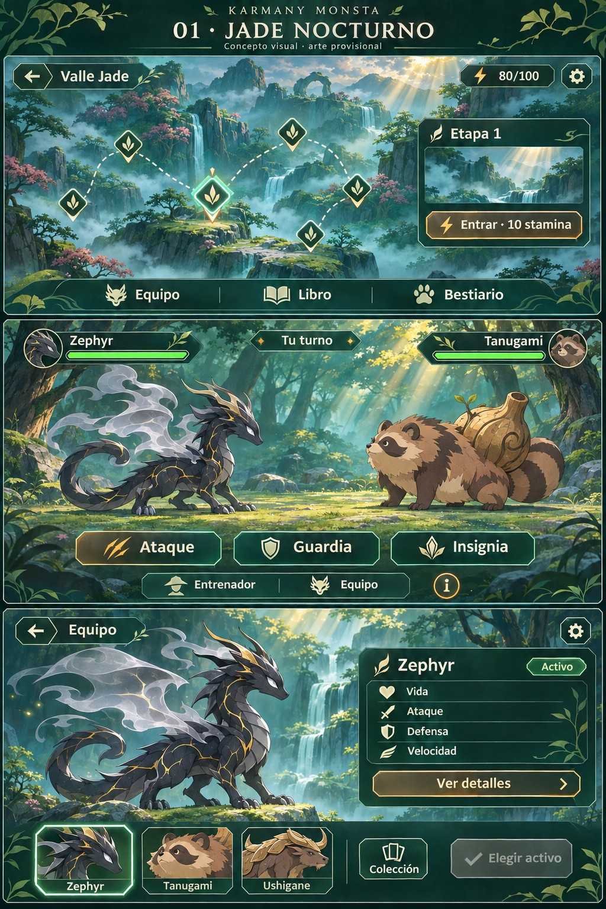

# Manual de componentes · Jade nocturno
Versión1 · 14/11/2026 · Proyecto Karmany Monsta Android

## Estado y propósito
El creador solicita integrar el inventario y preparar el archivo de diseños antes de generar todas las piezas. Preview46 es una adaptación técnica inicial: su resultado visual fue considerado insuficiente respecto al concepto elegido. La CI satisfactoria no representa aprobación artística. No integrar PR23/dev/main por esta petición documental.

Este manual fija el alcance de producción visual; no modifica reglas, estadísticas, contenido canónico ni guardados. Sustituye cualquier interpretación de que la aplicación de colores en Preview46 completó Jade nocturno. Los nuevos diseños se presentan para aprobación antes de incorporarlos al juego. La generación de la lámina maestra es el siguiente trabajo, no una entrega realizada aquí.

## Referencia y dirección

Imagen aportada por el creador: concepto de exploración, combate y equipo. Se conserva sin modificar como referencia de dirección; no como textura utilizable ni fuente de reglas. Sus nombres de acción, cifras, criaturas dibujadas y localizaciones no sustituyen el canon del repositorio.

- Sensación: misterio y fantasía con momentos luminosos.
- Formas: contornos biselados, paneles limpios, símbolos propios y ornamentación vegetal contenida.
- Materiales: verde profundo, marfil, detalles dorados y luz jade; evitar paneles planos genéricos.
- Composición: escenario y criaturas protagonistas; controles agrupados, espacio libre y jerarquía clara.
- Combate: información esencial visible y detalles al tocar.
- Fidelidad: conservar denominaciones funcionales del proyecto (por ejemplo Golpe/Protección); la imagen no autoriza renombrarlas a Ataque/Guardia.
- Identidad propia de Karmany Monsta: sin imitar interfaces Android estándar ni copiar arte de otros juegos.

## Cómo usar el inventario
Cada ID identifica una familia, no un único archivo: por ejemplo iconos de navegación requiere varias piezas, y cada botón requiere estados. El [catálogo editable](catalogo.csv) registra el avance por familia; los archivos individuales se anotan en el [registro de imágenes](imagenes/registro.csv). Inicialmente todas las familias están pendientes: los recursos simples de Preview46 no cuentan como diseños finales aprobados.

## Identidad y estructura

| ID | Familia | Piezas / alcance |
|---|---|---|
| JN-BASE-01 | Identidad | Título, emblema y encabezados de pantalla |
| JN-BASE-02 | Tipografía | Títulos, nombres, cifras y texto explicativo; tamaños normales/grandes |
| JN-BASE-03 | Marcos | Exterior, esquinas biseladas, borde interior y ventanas pequeñas |
| JN-BASE-04 | Ornamentación | Hojas, ramas, filigranas, separadores y símbolos decorativos |
| JN-BASE-05 | Materiales | Verde profundo, transparencia controlada, marfil, dorado y luz jade |
| JN-BASE-06 | Paneles | Principal, tarjeta informativa, lateral, franja inferior y ventana superpuesta |
| JN-BASE-07 | Fondos | Tratamiento por pantalla, zonas de lectura y separación ilustración/controles |

## Controles y navegación

| ID | Familia | Piezas / alcance |
|---|---|---|
| JN-CTRL-01 | Botones principales | Entrar, continuar y confirmar; silueta y acabado propios |
| JN-CTRL-02 | Botones secundarios | Consultar, cambiar, cancelar y auxiliares |
| JN-CTRL-03 | Botones de combate | Golpe, Protección e Insignia con jerarquía y símbolos diferenciados |
| JN-CTRL-04 | Botones de icono | Volver, cerrar, ajustes, información, ayuda y flechas |
| JN-CTRL-05 | Barra de navegación | Equipo, Libro y Bestiario; variantes según pantalla |
| JN-CTRL-06 | Pestañas y filtros | Categorías, rarezas y selección activa |
| JN-CTRL-07 | Interruptores | Sonido, vibración, texto grande y movimiento reducido |
| JN-CTRL-08 | Deslizadores | Pista, relleno, tirador y lectura de volumen |
| JN-CTRL-09 | Listas desplazables | Separadores, barra e indicación de contenido adicional |
| JN-CTRL-10 | Selectores técnicos | Desplegables y controles numéricos del laboratorio |

## Iconografía propia

| ID | Familia | Piezas / alcance |
|---|---|---|
| JN-ICO-01 | Navegación | Volver, cerrar, ajustes, ayuda, información y flechas |
| JN-ICO-02 | Secciones | Equipo, colección, Libro, Bestiario, entrenador y árbol de resonancias |
| JN-ICO-03 | Combate | Golpe, Protección, Insignia, cambio de criatura y resonancias existentes |
| JN-ICO-04 | Estadísticas | Vida, ataque, defensa, velocidad, nivel y experiencia |
| JN-ICO-05 | Exploración | Stamina, localización, ruta, entrada y recompensa |
| JN-ICO-06 | Estados | Activo, reserva, seleccionado, bloqueado, completado y disponible |
| JN-ICO-07 | Ajustes | Sonido, volumen, vibración, texto y movimiento reducido |

## Componentes por pantalla

| ID | Familia | Piezas / alcance |
|---|---|---|
| JN-PANT-01 | Inicio | Título/criatura protagonista, menú, continuar y confirmación de nueva partida |
| JN-PANT-02 | Selección de regiones | Tarjetas ilustradas, nombre, progreso, disponibilidad y requisitos |
| JN-PANT-03 | Mapa | Marcadores, conexiones, selección luminosa, estados, cabecera y stamina |
| JN-PANT-04 | Ficha de localización | Panel lateral, ilustración, nombre, datos reales, coste y entrada |
| JN-PANT-05 | Exploración | Escenario, información contextual, acciones y avisos |
| JN-PANT-06 | Combate: cabecera | Retratos enmarcados, nombres, PS, nivel e indicador de turno |
| JN-PANT-07 | Combate: acciones | Tres principales, entrenador/equipo, detalles y distribución táctil |
| JN-PANT-08 | Combate: ventanas | Detalles/técnicas, entrenador/resonancia, miembro y opciones |
| JN-PANT-09 | Resultados | Victoria/derrota, recompensas, XP por miembro, nivel y continuación |
| JN-PANT-10 | Vinculación | Libro, intentos, acción, éxito y fallo/escape |
| JN-PANT-11 | Equipo | Criatura protagonista, nombre, activo/reserva, estadísticas y acciones |
| JN-PANT-12 | Selector de equipo | Retratos inferiores, selección luminosa, huecos y colección |
| JN-PANT-13 | Colección | Tarjetas de individuos, selección, resumen e incorporación |
| JN-PANT-14 | Bestiario | Tarjetas de especie, siluetas, filtros, rareza, registro y ficha |
| JN-PANT-15 | Libro | Ilustración, nivel equipado, probabilidades reales, mejoras, requisitos y confirmación |
| JN-PANT-16 | Perfil de Ezel | Retrato, identidad, nivel/XP, puntos y resumen de equipo/resonancias |
| JN-PANT-17 | Árbol de resonancias | Nodos, conexiones, aprendizaje, selección, ficha y navegación |
| JN-PANT-18 | Resonancias equipadas | Espacios, selección y acciones reales de equipar/retirar |
| JN-PANT-19 | Configuración | Grupos visuales, controles propios y distribución accesible |
| JN-PANT-20 | Prólogo y tutorial | Diálogo, nombre, avanzar/omitir, ayuda y pasos |
| JN-PANT-21 | Diagnóstico y laboratorio | Paneles, formularios, aviso QA, mensajes y confirmaciones |

## Respuesta visual y movimiento

| ID | Familia | Piezas / alcance |
|---|---|---|
| JN-FX-01 | Ventanas | Aparición/cierre |
| JN-FX-02 | Pulsación | Respuesta al tocar |
| JN-FX-03 | Selección | Brillo en equipo y mapa |
| JN-FX-04 | Barras | Variación de PS y experiencia |
| JN-FX-05 | Celebraciones | Recompensa, nivel y vinculación |
| JN-FX-06 | Avisos | Error, acción bloqueada y problemas de guardado |
| JN-FX-07 | Transiciones | Exploración, combate y resultados |
| JN-FX-08 | Accesibilidad | Alternativas sin movimiento |

## Estados y comportamiento
Diseñar normal, pulsado, seleccionado, enfocado y deshabilitado donde tengan sentido; bloqueado cuando corresponda. En mapa/árbol distinguir disponible, completado/aprendido y requisitos pendientes según el modelo real. No diferenciar estados solo por color: usar borde, forma, símbolo y texto.

La zona táctil incluye margen invisible y no se limita al contorno ornamental. Como objetivo de validación móvil, mantener blancos táctiles equivalentes a48dp como mínimo, comprobados con la escala efectiva del dispositivo; no confundir unidades del lienzo Godot con dp Android. Separar acciones cercanas y comprobar gesto Atrás, áreas seguras, selección sin arrastre accidental y desplazamiento.

## Producción de imágenes y recursos
1. Preparar lámina de propuesta con piezas ampliadas, estados y aplicación en contexto.
2. Producir piezas aisladas además de la composición; una captura completa no sustituye los recursos.
3. Para fondos/ilustraciones usar PNG o WebP; preservar el original. Para piezas recortadas, PNG RGBA con transparencia real.
4. Para marcos/iconos preferir SVG originales cuando el acabado lo permita. Incluir PNG de revisión y la fuente editable.
5. Mantener texto, cifras, PS, XP y probabilidades como elementos vivos de Godot. El texto en las láminas solo ejemplifica jerarquía.
6. Especificar tamaño original, escala prevista, zonas extensibles y márgenes NinePatch de cada marco; no estirar ornamentos.
7. Diseñar sobre composición horizontal1280×720 y revisar960×540, pantallas más anchas, áreas seguras y texto grande. Son objetivos de composición, no límites fijos del teléfono.
8. Efectos/movimiento: entregar secuencia de fotogramas o storyboard, duración propuesta y alternativa de movimiento reducido. Implementación posterior en Godot.
9. No añadir iconos de afinidades, rarezas, recursos o acciones que no existan. Dudas de canon se resuelven con documento maestro y datos; si no bastan, preguntar.
10. Registrar procedencia/autor y licencia cuando corresponda, además de prompt/modelo si se generó con IA. No presentar una propuesta como aprobada sin evidencia del creador.

## Revisión antes de aprobar
- Reconocible como Jade nocturno por formas/materiales/ornamentación/composición, no solo por paleta.
- Consistencia entre familias y todas las pantallas.
- Legibilidad sobre fondos, con texto grande y estados deshabilitados.
- Controles diferenciados; escenario y criaturas con protagonismo.
- Botones completos, sin recortes ni solapamientos en resoluciones de prueba.
- Reutilización de componentes y escalado sin distorsión.
- Archivos aislados, transparencias correctas, nombres y registro completos.
- Nada de datos inventados; sin cambios de lógica para hacer coincidir una maqueta.
- Aprobación visual explícita antes de integración y prueba física después de implementación.

## Orden de trabajo
1. **Kit maestro:** identidad, tipografía, materiales, marcos, paneles, botones y estados.
2. **Iconos, mapa y combate:** iconografía, marcadores, retratos, barras y menús.
3. **Equipo y progresión:** colección, Bestiario, Libro, perfil y resonancias.
4. **Composiciones y situaciones:** pantallas completas, configuración, tutorial, resultados, vinculación y efectos.

No generar todas las familias antes de revisar el kit maestro: una aprobación de su lenguaje gráfico permite mantener coherencia en el resto. La aprobación de una lámina no valida automáticamente cada recurso derivado.

## Archivo de diseños y trazabilidad
Ver [guía del espacio de imágenes](imagenes/README.md). Propuestas/aprobados se guardan dentro de docs, fuera de assets de ejecución; el export actual ya excluye docs/*. Un archivo .gdignore evita importar este archivo de diseño en Godot. Solo las piezas aprobadas y preparadas pasan luego a assets/ui/jade u otra carpeta del juego mediante un cambio explícito.

Registrar en catalogo.csv: pendiente → propuesta → en_revision → aprobado → implementado. Una revisión solicitada puede devolver una familia a propuesta. Las revisiones superadas permanecen como historial, sin borrar la evidencia de aprobación previa. En una familia con muchas piezas, anotar estados parciales en notas; no marcarla aprobada si faltan piezas.

## Continuación
Responsable: WORK. Próxima entrega: lámina del kit visual maestro con estados, seguida de revisión del creador. Instrucción: «En feature/jade-nocturno lee docs/diseno/jade-nocturno/README.md; diseña la lámina del kit maestro siguiendo la referencia y registra sus propuestas sin marcarlas aprobadas ni modificar el juego».
